# 答辩方法理论包：Markov 与 Lancet 健康收益

这份讲义供毕业答辩前补方法学基础。先把概率和矩阵讲到能自己算一个小例子，再接到全国 COPD 状态转移模型，然后逐个解释概率敏感性分析里的分布，最后讲 Lancet 死因模块的健康收益。公式旁边标明来源：Blitzstein 的节号、健康决策文献，或本研究代码与方法稿。课堂小例子会标明「教学数字」。模型数字只用已经冻结的点值和参数表。

公式都写成单独的等宽文本块。在 VSCode 里打开本文件，或用普通预览，都能直接读到完整算式，不依赖 LaTeX 插件。

阅读顺序：第 1–10 节是基础；第 11–20 节是 Markov 模型；第 21–23 节是抽样分布；第 24–26 节是 Lancet 模块。文末「问答卡」只有题目。已有题目不删，以后每增加一节就在清单末尾加题。

主教材是本机的 Blitzstein 与 Hwang，*Introduction to Probability*，第 2 版（Chapman and Hall/CRC；Harvard Stat 110）。矩阵对照本机 MIT 18.06 笔记和许以超《线性代数与矩阵论》，以及该书附录 A.3、B.2。健康决策文献用来补队列模拟、半周期校正和 Dirichlet 这个名称：Briggs、Claxton、Sculpher，《Decision Modelling for Health Economic Evaluation》（Oxford，2006）；Sonnenberg 与 Beck，*Medical Decision Making* 1993；Siebert 等，ISPOR-SMDM 状态转移建模报告，*Value in Health* 2012；Briggs 等，ISPOR-SMDM 参数不确定性报告，*Medical Decision Making* 2012。

## 0. 两条通道先分开

本研究里有两套健康收益，回答的问题不同，死亡人数要分开报。

Markov 通道是患者状态模型。对象是 2025–2049 年中国 40 岁及以上 COPD 患者。它按年推进各状态的期望人数。干预改变的是加重概率；死亡收益来自下一年及以后严重加重史分布的改变。代码写明没有即时的干预死亡系数。计算定义以 `markov/Code/Model/COPD_v13_初学者逐行注释_总代码.R` 为准，讲解口径同时对照 `markov/Presentation/Article_report_20261101/COPD_v13_文章汇报_逐页讲稿与备查_20261102.md`。

Lancet 通道是一般人口的死因死亡率模型。它参照 NCD Countdown 2030（*Lancet* 2022;399:1266–1278）的覆盖扩展框架。首轮只计算急性无创通气。临床死亡相对效应直接作用在 COPD 根本死因死亡率上。方法稿是 `第五阶段_证据补齐与首轮结果汇报_2026-11-10/reports/Lancet模块_方法与首轮结果.Rmd`。

同名服务即使两边都出现，收益也分开存放。Markov 里的家庭 NIV 用的是加重风险比 0.71；Lancet 模块里的急性 NIV 用的是住院死亡风险比 0.54。它们是两个效应，对应两套人群算法。

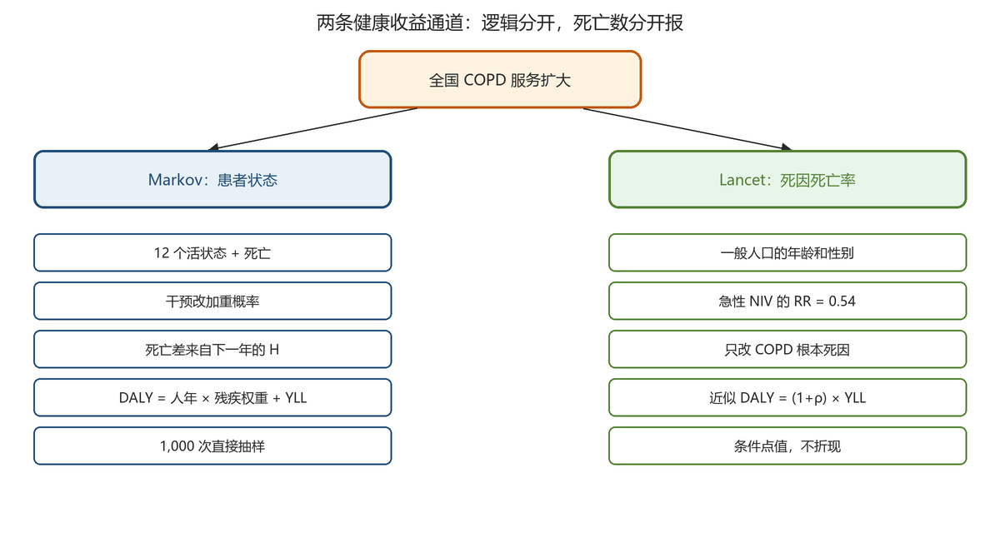

上图是全文的逻辑总图。左边一列回答「患者在各临床状态之间怎样移动」。右边一列回答「一般人口里，COPD 作为根本死因的死亡率怎样随覆盖变化」。两条线最后都报出死亡和健康年，但相加没有定义：左边的死亡是患者全因死亡，右边的死亡差里既有 COPD 死因死亡，也有净避免的全因死亡。

本文按教材的知识顺序写。定义、推导和数字例子都写在本文里，读的时候不必另翻原书。教材页有版权，这里不粘贴书页原文，而是把同一个知识点用能够手算的例子重新讲完。图也是按这些公式重新画的，图中的曲线可以用第 4 节和第 7 节的式子复核。

# 第一部分 基础理论

这一部分假定读者还没有系统学过概率。每一节都按同一顺序：先说这个词在生活里指什么，再写公式，再用一组很小的数字把公式算完，最后指出它在本研究的哪一步出现。教学数字是为了把算术做完，不会被写进论文结果。

先认识后面反复出现的记号。

- 下标是「这一个数属于谁」。n_H0 是处在 H0 的人数，q_g 是第 g 级的死亡概率。
- exp(x) 就是 e 的 x 次方，e 约等于 2.71828。exp(−0.10) 约等于 0.90484。
- ln 是自然对数，和 exp 互为逆运算。ln(0.90) 约等于 −0.10536，所以 exp(−0.10536) 回到 0.90。
- 求和号 Σ 就是把一类数加起来。Σ Nq 表示每一格都算一次「人数乘死亡概率」，再把这些格相加。
- 一行里的乘号写成 ×，减号写成 −。0.70 这种小数就是百分数里的 70%。

## 0.1 分布确实是函数，但要分清纵轴是什么

一个分布回答的是：随机结果会以多大的机会落在各个位置。把「位置」放在横轴，把「机会的描述」放在纵轴，得到的就是一个函数。函数有两种常用画法，读图的规则不同。

离散结果只有有限个位置，例如 H0、HS、死亡。这时用概率质量函数。纵轴的高度本身就是概率。三根柱子的高度相加必须等于 1。知道高度，就知道抽到这一格的机会。

连续结果可以落在一整段数上，例如一个 0 到 1 之间的比例，或一个大于 0 的相对风险。单看某一个精确的点，概率是 0，因为点没有宽度。这时用概率密度函数。纵轴的高度不是概率。概率等于曲线下面的面积。整条曲线下面的总面积等于 1。曲线高的地方，随机抽取更常落在附近；曲线低的地方，抽到的机会小。

还有一条累计函数，叫分布函数。它的纵轴才又是概率：F(x) = P(X ≤ x)，从最左端的 0 升到最右端的 1。密度是这条累计曲线的斜率。本文的图主要画密度和柱状概率，因为抽样时眼睛先看「峰在哪里、有多瘦」。

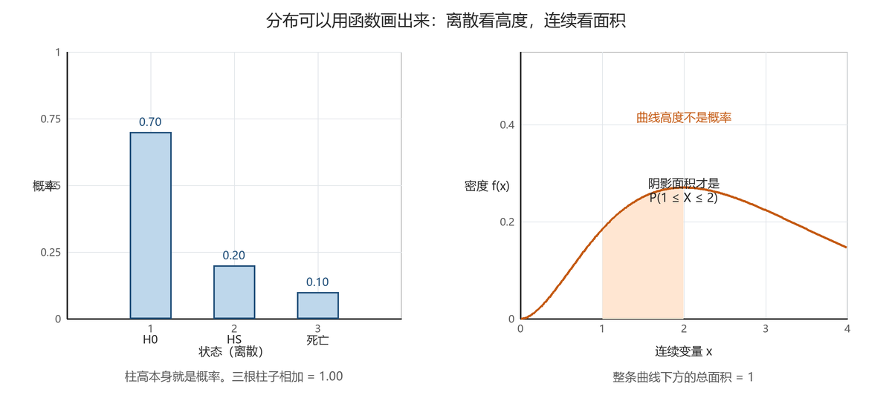

左图是第 1 节练习表的第一行：0.70、0.20、0.10，三根柱子相加为 1。右图是一条连续密度，阴影是从 1 到 2 这一段的面积。口头说「这个分布」时，指的就是这样一张完整的函数，而不只是一个均值。均值是函数的一个摘要：把所有位置按密度加权平均。方差是另一个摘要：离开均值的平方，再按密度加权。PSA 每次抽样，是按整条函数来抽一个数，不是只把均值拿来用一次。

读后面的每一张分布图，都按这四步：

1. 横轴是什么量，单位是概率、相对风险，还是正的等待时间。
2. 纵轴是柱高（概率）还是密度（面积才是概率）。
3. 峰的位置靠近哪个点估计。
4. 峰瘦表示抽出来的数挤在峰附近；峰宽表示同样次数的抽样会散得更开。

## 1. 向量、矩阵，以及人数乘转移矩阵

### 1.1 先把人分成互斥的几格

假设这一年初有 1000 名患者，并且规定每个人恰好属于下面三类之一：

- H0：过去一年没有加重，800 人
- HS：过去一年有严重加重，200 人
- 死亡：0 人

这 800、200、0 已经是按固定顺序排好的三个数。按这个顺序写成一行，就叫行向量：

```text
n0 = ( n_H0, n_HS, n_死亡 ) = ( 800, 200, 0 )
```

向量在这里没有几何里「箭头」的意思。它只是一张有顺序的名单，好让后面的乘法对准位置。Blitzstein 第 11 章和附录 A.3 用的就是这种行向量；MIT 18.06 把矩阵乘法定义成「一行配一列，逐项相乘再相加」，和这里的算法相同。

人数必须能加回总数。800 + 200 + 0 = 1000。如果有人被同时放进 H0 和 HS，总数就会被加两次，后面的转移就没有意义。所以状态要互斥，并且把所有可能都包括进来。死亡也占一个位置，即使今年还是 0。

### 1.2 转移矩阵是一张「从哪来、到哪去」的概率表

矩阵就是一张长方形的表。转移矩阵专门回答：现在处在某一格的人，下一步落到每一格的概率是多少。

教学用的一张表如下。它只用来练习乘法，本研究的真实概率在第 13 节。

```text
            下一步 H0    下一步 HS    下一步死亡
现在 H0        0.70         0.20          0.10
现在 HS        0.40         0.40          0.20
现在死亡       0            0             1
```

读第一行：一个现在是 H0 的人，下一步仍是 H0 的概率是 0.70，变成 HS 的概率是 0.20，死亡的概率是 0.10。Blitzstein 定义 11.1.2 把第 i 行第 j 列的这个概率记成 q_ij，整张表记成 Q。

每一行都要检查两件事。

第一，格子里的数都大于或等于 0，因为它们是概率。第二，每一行加起来等于 1，因为这个人下一步必须去某个地方。

```text
H0 行：  0.70 + 0.20 + 0.10 = 1
HS 行：  0.40 + 0.40 + 0.20 = 1
死亡行： 0    + 0    + 1    = 1
```

行之和为 1、且每个元素非负的矩阵，叫行随机矩阵。死亡行是 (0, 0, 1)：已经死亡的人下一步仍在死亡，概率是 1。这种「进去以后留在原地」的状态叫吸收态。

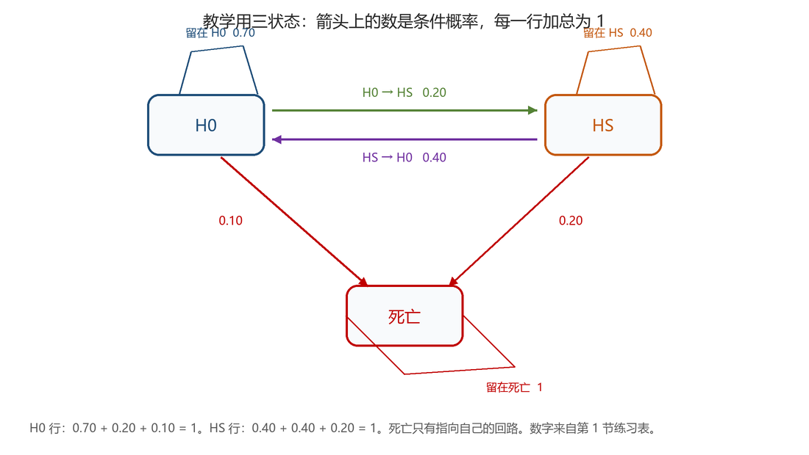

把同一张表画成箭头以后，可以逐条核对。从 H0 出发的三条边是 0.70、0.20 和 0.10。从 HS 出发的三条边是回到 H0 的 0.40、留在 HS 的 0.40、进入死亡的 0.20。死亡只有回到自己的那一条，概率是 1。图中的数都是条件概率。人数要另外乘上去，那是下一小节的乘法。

### 1.3 用一行人数去乘这张表

下一步的期望人数，等于现在的人数行向量乘上 Q。Blitzstein 把初始分布也放在矩阵左边：

```text
n1 = n0 × Q
```

矩阵乘法的规则可以只记一句：新向量的每一格，等于「旧向量的每一格 × 该格所在行、新格所在列的那个概率」，再把这些乘积相加。

上面 800 个 H0 和 200 个 HS，下一步仍在 H0 的期望人数是：

```text
来自 H0 的：  800 × 0.70 = 560
来自 HS 的：  200 × 0.40 =  80
来自死亡的：    0 × 0    =   0
加总：                     640
```

下一步在 HS 的期望人数是：

```text
800 × 0.20 + 200 × 0.40 + 0 × 0 = 160 + 80 + 0 = 240
```

下一步死亡的期望人数是：

```text
800 × 0.10 + 200 × 0.20 + 0 × 1 = 80 + 40 + 0 = 120
```

所以

```text
n1 = ( 640, 240, 120 )
```

640 + 240 + 120 = 1000。人没有变多，只是在三格之间重新分配，其中 120 人进入死亡后再也不回来。

如果下一年仍用同一张 Q，就把 n1 再乘一次 Q，得到 n2。把「乘同一张 Q」重复 n 次，写成 Q 的 n 次方。Blitzstein 定义 11.1.4：从 i 出发、恰好 n 步以后在 j 的概率，是 Q 的 n 次方那张表里第 i 行第 j 列。两步之所以是 Q × Q，是因为中间必须落在某一个状态，第一步的概率乘第二步的概率，再把所有中间状态加起来。

### 1.4 矩阵每年更换时，不能写成同一个 Q 的 25 次方

若第二年的转移表换成另一张 Q2，正确的算法是 n1 × Q2，而不是把第一张表平方。本研究就是这种情形：年龄增加一岁，覆盖率改变，当年用来校准死亡的人口构成也改变，所以每一年有自己的 Q_t。25 年后的人数是

```text
n25 = n0 × Q1 × Q2 × … × Q25
```

并且每一年还要把新进入的患者加进对应的格子。平稳分布和特征值讨论的是「同一张 Q 使用很多很多次以后，比例会停在哪里」。第 9 节说明本研究为什么不算那个长期比例。

本研究代码没有把 12 个临床状态手写成一张 13×13 的矩阵再调用矩阵乘法函数。它按格子计算「人数 × 概率」，再把结果放进下一格。这和上面的行向量乘 Q 是同一种算术，只是状态名单更长。

## 2. 条件概率、独立性和全概率

### 2.1 条件概率就是「已经知道现在在哪一格」

无条件概率问的是：从全体人里随便看一个人，某件事发生的机会。条件概率问的是：已经知道他属于某一类之后，这件事的机会还剩多少。

用 100 人做一次手算。其中 40 人过去一年有严重加重（HS），60 人没有（H0）。随访一年后，HS 里死了 16 人，H0 里死了 6 人。

```text
P(死亡 | HS) = 16 / 40 = 0.40
P(死亡 | H0) =  6 / 60 = 0.10
```

竖线读作「在……的条件下」。Blitzstein 第 2.2 节的定义是

```text
P(A | B) = P(A 且 B) / P(B)     要求 P(B) > 0
```

用这 100 人核对：死亡且 HS 的人数是 16，HS 的人数是 40，16/40 仍是 0.40。

转移概率就是这种条件概率。q_ij 表示「现在处于 i，下一步处于 j」。已知现在的状态以后，再往前翻病历，按 Markov 性的定义不再改写这个概率。第 9 节把这句话写成正式定义；这里先把转移概率理解成条件概率。

### 2.2 全概率是把各类的条件概率按人数加权

全体 100 人的死亡概率，等于两类死亡概率按人数占比加权：

```text
P(死亡) = (40/100) × 0.40 + (60/100) × 0.10
        = 0.40 × 0.40 + 0.60 × 0.10
        = 0.16 + 0.06
        = 0.22
```

直接数人数也是 16 + 6 = 22，22/100 = 0.22。两种算法一致。Blitzstein 第 2.3 节把这件事写成全概率公式。若几类 G_g 互斥、并且盖住全体，则

```text
q = Σ  π_g × q_g
```

π_g 是第 g 类的比例，q_g 是该类的条件概率。上例里 π_HS = 0.40，π_H0 = 0.60。

本研究的 GOLD 死亡校准就是在使用这个等式。先规定各级死亡概率之间的相对梯度，再求一个共同强度，使加权结果正好等于该年龄、该性别当年已经确定的 COPD 死亡概率。H0、HM、HS 的校准是同一件事，只是分类从 GOLD 换成了加重史。

### 2.3 独立是一项需要单独声明的设定

两个事件独立，是指知道其中一个以后，另一个的概率保持原值：P(A | B) = P(A)。两个随机变量独立，是指知道一个的取值以后，另一个的分布不变（Blitzstein 3.8）。

抛一枚硬币和明天是否下雨，可以当作独立的教学例子：看到硬币正面，不改变下雨的概率。同一座城市里两个患者今年是否死亡，则常常不独立，因为他们共享流感、寒潮和医院负荷。

本研究的概率敏感性分析里，肺康复风险比和家庭 NIV 风险比各自独立抽取。两项三联效应故意共用一个随机数，所以它们不独立。独立与否是写进抽样方案的决定，抽样程序不会自动判断两个参数在临床上是否独立。

## 3. 期望、指示变量，以及为什么可以不逐人模拟

### 3.1 随机变量和期望

随机变量把每一个可能结果对应到一个数（Blitzstein 3.1）。例如「今年的死亡人数」在不同的随机结果里可以是 90、100 或 110。它的期望，是这些数按概率加权以后的平均值（Blitzstein 4.1）。期望是一个确定的数，用来代表这个随机量的中心，它本身不再随机。

用一个只有两个结果的人来看。他今年死亡的概率是 0.10，存活的概率是 0.90。若规定死亡记 1 人、存活记 0 人，则

```text
期望死亡人数 = 1 × 0.10 + 0 × 0.90 = 0.10
```

0.10 个人在现实里不会出现。它的意思是：大量结构和他相同的人，平均每人贡献 0.10 个死亡。

### 3.2 指示变量把「发生与否」变成 0 和 1

指示变量 I_A 只取两个值：事件 A 发生时等于 1，不发生时等于 0。Blitzstein 4.4 的基本桥是

```text
E(I_A) = P(A)
```

上面那个人的死亡指示变量，期望就是 0.10，和他的死亡概率相同。这个桥把「概率」和「人数的期望」接在一起：概率本来就是 0–1 指示变量的期望。

### 3.3 期望可以相加，不管这些人是否互相独立

期望的线性性（Blitzstein 4.2）说：几个随机变量之和的期望，等于各自期望之和。这个加法不要求它们独立，也不要求它们服从同一种分布。

四个人的死亡概率分别是 0.25、0.25、0.50 和 0。四个人死亡指示变量的期望之和是

```text
0.25 + 0.25 + 0.50 + 0 = 1.00
```

所以这四人的期望死亡人数是 1。真做一次随机，可能死 0 人、1 人或 2 人。某一次的结果可以离开 1，多次重复的平均值靠近 1。

若 1000 个结构相同的人，每人死亡概率都是 q，则期望死亡人数是

```text
E(I_1 + … + I_1000) = 1000 × q
```

年初 N 人、死亡概率 q 时，期望死亡人数就是 N × q。代码写成 `deaths <- weight * q`。这里用的是期望的加法。即使这 1000 人因为同一个寒潮而一起升高死亡风险，只要每个人的死亡概率仍是 q，期望死亡人数就仍是 N × q。相关会改变「死亡人数上下波动的幅度」，也就是方差；它不改变这个期望。

### 3.4 队列模型推进的是期望人数

队列模型逐年填写的，是每一格的期望人数。它不给每个人抽一次「死或不死」。逐人抽签叫微观模拟，也叫一阶蒙特卡罗（Siebert 等，ISPOR-SMDM 2012）。微观模拟适合必须记住很长的个人轨迹、状态多到无法列表的情形。

本研究把需要记住的病史写成「过去一年的加重史」这一个分类。12 个活状态可以列表，因此用队列期望人数。Briggs、Claxton、Sculpher 第 2 章把这种做法称为队列 Markov 模型。

由此也可以区分两种随机。患者层面的随机，在队列模型里已经被期望吸收掉了：输出是 N × q，而不是某一次抽签的死亡人数。参数层面的随机留在概率敏感性分析里：先抽取效应和权重，再把整条队列重跑一遍。PSA 抽的是参数，不是每个患者的生死。

## 4. 正态、指数，以及年内恒定强度

### 4.1 正态：对称地分布在一个中心两侧

标准正态 Z 的中心在 0，两侧对称，常用记号 Z ~ N(0, 1)（Blitzstein 5.4）。大约 95% 的标准正态落在 −1.96 到 1.96 之间。一般正态由中心 μ 和标准差 σ 生成：

```text
X = μ + σ × Z
```

σ 越大，X 越分散。PSA 里两项三联效应共用的，就是同一个 Z。Z 为正时，两个效应一起变大；Z 为负时，两个效应一起变小。第 6 节用数字把这一步算完。

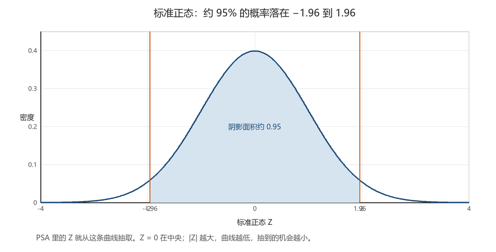

这张图的横轴是 Z，纵轴是密度。中央最高，两侧下降。橙色竖线在 −1.96 和 1.96。阴影面积约 0.95，所以一次抽取落在两条竖线之间的机会大约是 95%。曲线在 0 处的高度大约是 0.40，这个 0.40 不是「抽到 0 的概率」。抽到恰好等于 0 的概率是 0。0.40 表示 0 附近每一小段的面积比较大。

`rnorm` 做的事，就是按这张图的面积来抽 Z。抽到 0 附近的次数多，抽到 3 以外的次数少。置信区间换算里的 1.96，就是这张图上左右各留下 2.5% 面积的那两个点。

### 4.2 概率和强度是两个单位

年度死亡概率 q 是一个 0 到 1 之间的数，表示这一年内至少死亡一次的机会。强度 λ 是「还没发生的人，在很短一段时间里发生的速度」，单位是每年。概率没有「每年」这个单位。

两者在数值上常常接近，但不能互换。若这一年内强度恒定为 λ，等到年底仍未发生的概率是 exp(−λ)，因此至少发生一次的概率是（Blitzstein 5.5）

```text
q = 1 − exp(−λ)
```

已经有概率 q 时，反解强度：

```text
λ = − ln(1 − q)
```

用 q = 0.10 做一次：

```text
λ = − ln(0.90) = 0.10536
1 − exp(−0.10536) = 0.10
```

若有人把强度 0.10 直接当成概率，会得到 0.10；按恒定强度换算，对应的概率其实是

```text
1 − exp(−0.10) = 0.09516
```

差别在这个例子里大约 0.005。强度一旦大于 1，差别就不再是小数点后的事。强度 1.5「每年」是允许的，概率不允许等于 1.5。恒定强度下的年度概率是

```text
1 − exp(−1.5) = 0.77687
```

指数函数把任意大的正强度压回 0 到 1 之间的概率。这是模型使用 exp 的原因。

### 4.3 无记忆性只用于一年的内部

指数分布有无记忆性（Blitzstein 5.5）：已知已经等了 s 年还没发生，再等 t 年才发生的概率，和从零开始等 t 年相同。教学说法是：一只服从指数寿命的灯泡，已经亮了三个月还没坏，它再撑一个月的概率，和一只新灯泡撑一个月的概率相同。它不因为已经用过三个月而变得更脆，也不变得更结实。

年内采用恒定强度，就是采用这个性质：这一年内部不再按「已经过去几个月」修改强度。跨年的记忆另有存放处。过去一年有没有严重加重，决定下一年从 H0、HM 还是 HS 出发。那是状态的记忆，和第 5.5 节的无记忆性放在两层。

### 4.4 至少一次，以及发生率比为什么写成乘方

泊松过程可以理解成：事件点以恒定强度落在时间轴上（Blitzstein 5.6）。一年内事件次数的期望是 λ。一次都不发生的概率是 exp(−λ)，至少发生一次的概率仍是 1 − exp(−λ)。

发生率比 IRR 作用在强度上。原强度是 λ 时，新强度是 IRR × λ。因为原概率 p = 1 − exp(−λ)，所以 exp(−λ) = 1 − p，新概率是

```text
p' = 1 − exp(− IRR × λ) = 1 − (1 − p) ^ IRR
```

用 p = 0.20、IRR = 0.70 算一次。

```text
λ = − ln(1 − 0.20) = − ln(0.80) = 0.22314
新强度 = 0.70 × 0.22314 = 0.15620
p' = 1 − exp(−0.15620) = 1 − (0.80) ^ 0.70 = 0.14461
```

若把 0.70 直接乘在概率上：

```text
0.20 × 0.70 = 0.14000
```

0.14461 和 0.14000 接近，但不相等。p 越小，两种算法越接近，因为这时 λ 和 p 几乎一样，IRR × p 就接近 1 − (1 − p) ^ IRR。p 越大，两种算法分得越开。

三联治疗使用乘方这一条，因为输入是发生率比，模型按恒定强度把它映射成「至少一次」的年度概率。肺康复和家庭 NIV 的输入是随访期风险比，代码把它们直接乘在概率上。两条映射都在第 17 节按代码顺序重写。

### 4.5 生命表里的另一种 q

中央死亡率 m 是死亡人数除以该岁的存活人年。若死者平均在年中死亡，由 m 得到年度死亡概率的常用近似是

```text
q = m / (1 + 0.5 × m)
```

m = 0.10 时，

```text
生命表近似：  0.10 / (1 + 0.05) = 0.09524
恒定强度：    1 − exp(−0.10)     = 0.09516
```

m = 0.50 时，

```text
生命表近似：  0.50 / 1.25 = 0.40000
恒定强度：    1 − exp(−0.50) = 0.39347
```

m 小的时候两式几乎相同；m 大的时候小数点后第二位就会分开。本研究两式都用，用途不同。状态转移里的 COPD 死亡概率用 1 − exp(−m)，代码在 `calc_q_copd`。给 YLL 用的时期寿命表用 m / (1 + 0.5 × m)，代码在 `v13_life_table`，100 岁以上开放组另设 q = 1。第 14 节和第 19 节各走各的公式。

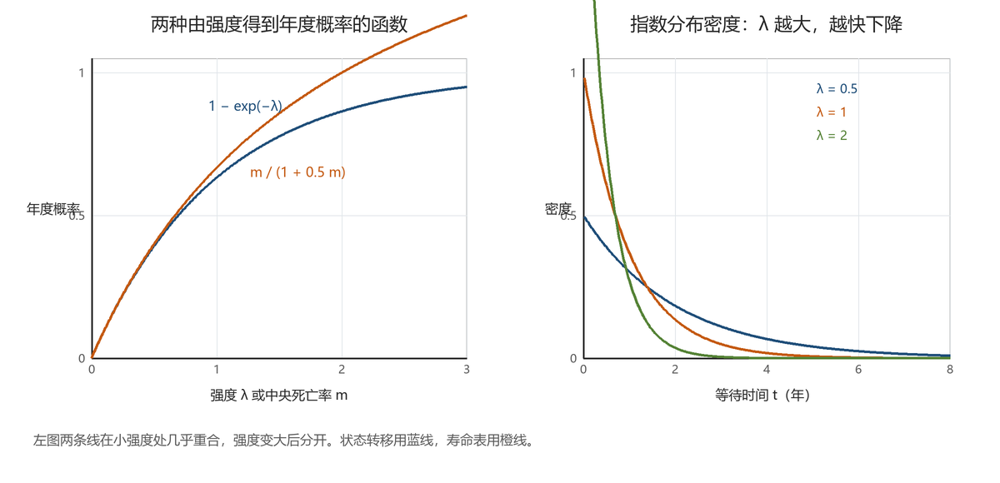

左图把两个函数画在同一张坐标上。横轴同时代表恒定强度和中央死亡率，纵轴是算出来的年度概率。蓝线是 1 − exp(−λ)，橙线是 m / (1 + 0.5 m)。靠近 0 的时候两条线贴在一起；横轴走到 2 或 3，橙线明显高于蓝线，因为两种近似对「死亡发生在一年中的哪一天」作了不同处理。右图是指数分布自己的密度。λ = 2 的曲线在 0 附近最高，然后很快掉下去，表示事件倾向于早发生。λ = 0.5 的曲线更平，事件在时间上摊得更开。年内模型使用的是左图的蓝线，也就是「这一年至少发生一次」的概率，不是右图上某一个时刻的密度高度。

## 5. 均值、方差和矩估计

### 5.1 用五个数把均值和方差算出来

分布的均值就是期望。方差是「每个数离开均值以后的平方」再取期望（Blitzstein 4.6、6.1）。平方是为了让左右两边的偏离都变成正数，并且让离得更远的点占更大分量。标准差是方差的平方根，单位和原数相同。

五个教学数字：1、2、3、4、5。均值是

```text
(1 + 2 + 3 + 4 + 5) / 5 = 3
```

每个数离开 3 的偏差是 −2、−1、0、1、2。平方是 4、1、0、1、4，平均值是

```text
(4 + 1 + 0 + 1 + 4) / 5 = 2
```

这是总体方差的一种算法。标准差是根号 2，约 1.41。以后看到「标准差 0.05」，可以把它理解成：这批数大体散布在均值上下大约 0.05 的范围，而不是精确地说每个数都差 0.05。

样本矩是用手头这批观测算出来的均值和方差（Blitzstein 6.3）。总体矩是分布公式里的理论均值和理论方差。矩估计的做法是让理论矩等于手头的矩，再反解分布里的参数。

### 5.2 标准差和标准误

标准差描述一群个体之间有多散。标准误描述一个估计值如果重复估计，会有多散。1000 名患者的年龄可以有很大的标准差；这 1000 人的平均年龄，其标准误会小得多。PSA 里写在 Beta 上的 se，是参数估计的标准误，用来决定这个 0 到 1 之间的参数有多不确定。它不是患者与患者之间的个体差。

### 5.3 Beta 的均值和方差，以及反解形状参数

Beta(α, β) 的理论均值和方差是（Blitzstein 8.3、8.5）

```text
均值 μ = α / (α + β)

方差 σ² = α × β / [ (α + β)² × (α + β + 1) ]
```

α 和 β 都是正数。均值只看二者的比例。α = 2、β = 6 时，均值是 2/8 = 0.25。把 α 和 β 同时乘 10，变成 20 和 60，均值仍是 0.25，方差会变小，分布更集中。所以形状参数越大，表示这个比例越被「看得更准」。

代码 `beta_mom` 走相反的路：已知均值 m 和标准误 se，求 α 和 β。记 v = se²，

```text
α = m × [ m × (1 − m) / v − 1 ]
β = α × (1 − m) / m
```

高碳酸血症比例用 m = 0.25、se = 0.05。一步一步算：

```text
v = 0.05² = 0.0025
m × (1 − m) = 0.25 × 0.75 = 0.1875
0.1875 / 0.0025 = 75
α = 0.25 × (75 − 1) = 0.25 × 74 = 18.5
β = 18.5 × 0.75 / 0.25 = 18.5 × 3 = 55.5
均值复核： 18.5 / (18.5 + 55.5) = 18.5 / 74 = 0.25
```

因此写成 Beta(18.5, 55.5)。18.5 和 55.5 是由均值和预设标准误算出来的形状，不是另一篇文献里的病人计数。残疾权重和效用也用这一套反解。持续份额 Beta(388, 147) 则是例外：那里的两个形状直接来自人数，第 7.2 节单独讲。

### 5.4 点值跑一次，和抽样后再平均，可以不同

1,000 次 PSA 结果的平均值，是这 1,000 个模型输出的样本均值。它靠近的是「参数按这些分布随机化之后，结局的期望」。确定性主分析把每个参数固定在一个点上，只跑一次。

一个函数的平均值，一般不等于「把平均值代进函数」。持续份额给出一个很小的可见差别：主分析用四舍五入的 0.725；Beta(388, 147) 的均值是 388/535，约 0.72523。对数正态还会把差别放大一点，因为取指数以后的均值等于 exp(μ + s² / 2)，比 exp(μ) 略大。第 7.1 节说明这一点。

## 6. 联合分布、相关和多项分布

### 6.1 两个变量放在一起

只看一个变量的分布，叫边际分布。两个变量同时看，叫联合分布（Blitzstein 7.1）。两个变量可以各自都是正态，联合起来仍有不同的绑定方式：一个变大时，另一个可能跟着变大、跟着变小，或完全不受影响。

协方差衡量它们是否同向偏离各自的均值。相关系数把协方差缩放到 −1 和 1 之间（Blitzstein 7.3）：

```text
Corr(X, Y) = Cov(X, Y) / 根号[ Var(X) × Var(Y) ]
```

相关系数为 0，表示按这一定义没有线性的同向或反向绑定。相关系数为 1，表示一个变量是另一个的严格正线性函数，没有额外的随机起伏。教学对照：两枚独立骰子的点数，知道第一枚是 6，不改变第二枚；若第二枚被规定成和第一枚永远相同，相关系数就是 1。

### 6.2 用一个 Z 把两个发生率比绑在一起

PSA 的构造是

```text
ln(R1) = ln(0.85) + Z × s1
ln(R2) = ln(0.75) + Z × s2
```

ln(0.85) 约 −0.16252，ln(0.75) 约 −0.28768。s1 约 0.030，s2 约 0.037，都是正数。Z 是同一个标准正态。因为两个对数都是这个 Z 的正倍数再加上常数，它们的相关系数是 1。这是二维正态的一个极端情形（Blitzstein 7.5）。

把 Z = 1 代进去看方向：

```text
R1 = exp(−0.16252 + 1 × 0.030) = exp(−0.13252) = 0.8759
R2 = exp(−0.28768 + 1 × 0.037) = exp(−0.25068) = 0.7783
```

点估计是 0.85 和 0.75。Z = 1 时两个数都变大。若 Z = −1，两个数都会变小。抽样时不会出现「0.85 那一项变大、0.75 那一项变小」。

这个相关系数等于 1，是模型设定。两项比较共用一个三联试验组，说明它们不是两个独立试验；由此得不出真实相关系数恰好等于 1。代码注释写明：未知真实协方差，这个相关结构是情景假设。

### 6.3 多项分布是「三类及三类以上的计数」

二项分布把一次试验分成成功和失败两类。多项分布把它推广到互斥的多类（Blitzstein 7.4）。各类概率加总为 1，各类计数加总为总人数。

REAL 的 GOLD I 有 430 人，其中 ICS/LABA 117 人，LAMA/LABA 3 人，其他 310 人。先核对计数：

```text
117 + 3 + 310 = 430
```

对应的观察比例是

```text
117 / 430 = 0.2721
  3 / 430 = 0.0070
310 / 430 = 0.7209
```

三者相加为 1。主分析把这些比例当作固定构成。PSA 再让构成本身随机化：抽三个正数，再除以它们的和，使结果仍是三个相加为 1 的比例，但不必每次都等于 0.2721、0.0070、0.7209。归一化的做法在第 7.3 节。

二联内部的权重只用前两类，不分摊「其他」。GOLD II 的计数是 ICS/LABA 498、LAMA/LABA 21，权重是

```text
w = 498 / (498 + 21) = 498 / 519 = 0.9595
```

这个 0.9595 是二联内部 ICS/LABA 的份额。它和 498/1775 不同，因为 1775 是该 GOLD 级的全部人数，分母里含有「其他」治疗。

## 7. 变量替换：对数正态、Beta 和 Gamma

若只需要 g(X) 的期望，Blitzstein 4.5 的 LOTUS 说，用 X 的分布直接对 g(X) 做加权平均即可，不必先做出 g(X) 的整张分布。若需要 g(X) 本身的分布，就要做变量替换（第 8 章）。本研究需要的是后一种：抽一个正态，再把它变成正的相对风险；抽几个 Gamma，再把它们变成相加为 1 的构成。

### 7.1 对数正态：先在对数上放正态，再取指数

设 Y = ln(X) 服从正态，则 X = exp(Y) 服从对数正态。指数把全体实数映到正数，所以对数正态的取值都大于 0。相对风险和发生率比都是正数，并且以倍数变化，所以健康决策模型通常在对数尺度上放正态，再取指数（Briggs 等，2012；Briggs、Claxton、Sculpher 第 4 章）。这就是 Blitzstein 8.1 的单调变量替换，用在正态和指数这一对函数上。

代码写成 `exp(rnorm(...))`。中心放在 ln(点估计)，标准差由 95% 置信区间的两端反推：

```text
s = [ ln(hi) − ln(lo) ] / [ 2 × qnorm(0.975) ]
```

qnorm(0.975) 约等于 1.96，分母约等于 3.92。这个 s 是对数尺度上的标准差。按此式：

```text
三联 vs ICS/LABA，区间 0.80–0.90， s 约 0.030
三联 vs LAMA/LABA，区间 0.70–0.81， s 约 0.037
肺康复，区间 0.58–0.85，           s 约 0.098
家庭 NIV，区间 0.58–0.87，         s 约 0.103
```

正式抽样以代码里的 `qnorm(0.975)` 为准，上面的 s 用来看数量级。区间越宽，s 越大，肺康复和家庭 NIV 的对数标准差大约是三联效应的三倍。

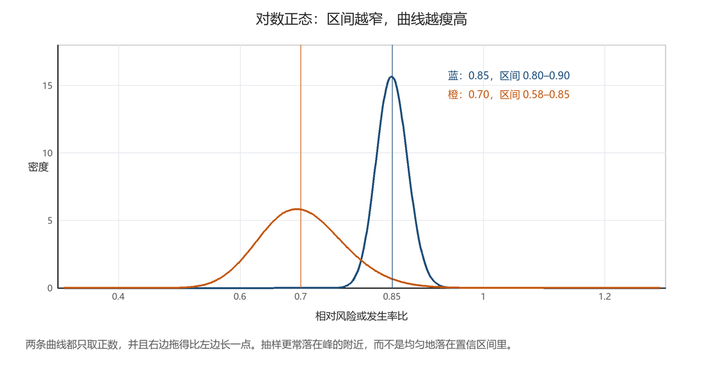

蓝线的中心在 0.85，置信区间只有 0.80 到 0.90，所以峰又高又窄。橙线的中心在 0.70，区间是 0.58 到 0.85，峰更矮，两尾拖得更远。纵轴到 15 左右仍然是密度，不是概率。一次抽样落在峰顶那一个点上的概率仍是 0；落在峰附近一小段里的概率，等于那一小段的面积。

两条曲线都不对称：从峰向右可以拖得比较远，向左则被 0 挡住。这就是先在对数上放一条对称的正态、再取指数的几何结果。正态在对数尺度上向左、向右同样远；取指数以后，向右的同样距离变成更大的倍数，向左的同样距离被压缩在 0 和峰之间。

对数正态的均值是 exp(μ + s² / 2)，比 exp(μ) 略大。s = 0.030 时，s² / 2 约 0.00045，exp(μ + s² / 2) 大约是点估计的 1.00045 倍，几乎看不出来。s = 0.103 时，s² / 2 约 0.0053，均值大约比点估计高 0.5%。所以 1,000 次抽样的平均相对风险会略高于 0.85、0.75、0.70 或 0.71。这是分布的性质。

### 7.2 Beta：一个限制在 0 和 1 之间的比例

Beta(α, β) 是 (0, 1) 上的连续分布，密度正比于 x 的 (α − 1) 次方乘以 (1 − x) 的 (β − 1) 次方（Blitzstein 8.3）。答辩时可以先不背密度，只记三件事：它的取值在 0 和 1 之间；均值是 α / (α + β)；α 和 β 越大，分布越集中。

当两个参数来自计数时，读法很直接。持续治疗 388 人，未持续 147 人，合计 535 人：

```text
388 + 147 = 535
均值 = 388 / 535 = 0.7252336
```

主分析把这个比例四舍五入成固定的 0.725。PSA 使用 Beta(388, 147)，每次抽一个仍在 0 到 1 之间的比例，这些比例的理论均值是 0.72523。两处故意保留这个差别。

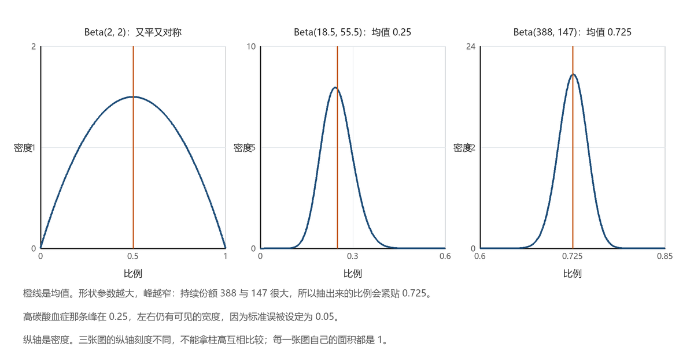

三张图都是 Beta 密度，纵轴刻度故意不统一，因为第三张峰太高，若和第一张共用一个纵轴，第一张会被压成一条贴地的线。

第一张 Beta(2, 2) 是对照。两个形状都很小，曲线从 0 到 1 铺开，在 0.5 最高，抽一次可能得到 0.2，也可能得到 0.8。它说明：均值等于 0.5，并不表示抽样结果总在 0.5。

第二张是高碳酸血症比例 Beta(18.5, 55.5)。橙线在 0.25。曲线在 0.15 到 0.35 之间还有可见的宽度，因为标准误被设成 0.05。抽 1,000 次，大多数点会落在 0.25 附近，但仍会有一些离开 0.25 大约 0.05 到 0.10。

第三张是持续份额 Beta(388, 147)。横轴只画了 0.60 到 0.85，因为外面的密度已经接近 0。橙线在 0.725。388 和 147 都很大，相当于已经观察了 535 个有明确归类的人，所以新抽的一个比例很难跑到 0.60 以下或 0.85 以上。峰高大约到 20，这个 20 仍是密度。把曲线下的面积加起来，仍然是 1。

可以把 388 理解成「持续」这一侧的重量，147 理解成「未持续」这一侧的重量。两侧都很大时，抽出来的比例会紧贴 388/535；若只有 4 对 1，均值仍是 0.80，但抽样会散得多。共轭更新把 Beta 当作二项概率的不确定分布。答辩时把 388 和 147 说成持续人数和未持续人数即可。

### 7.3 Gamma，以及为什么相除以后得到 Beta

Gamma(a, λ) 取正数。a 叫形状，λ 叫速率。形状越大，分布越往右移并相对更集中。整数形状、相同速率的独立 Gamma 之和仍是 Gamma，形状相加（Blitzstein 8.4；和的分布也可用 8.2 的卷积理解）。等待时间的指数分布是形状为 1 的 Gamma。

Blitzstein 8.5 用一个银行和邮局的故事把 Beta 和 Gamma 接起来。X 是银行等待时间，服从 Gamma(a, λ)；Y 是邮局等待时间，服从 Gamma(b, λ)；两者独立，速率相同。总等待时间 T = X + Y，银行占的比例是

```text
W = X / (X + Y)
```

则 W 服从 Beta(a, b)，并且 W 与总时间 T 独立。速率 λ 在分子和分母里同时出现，相除时被约掉。所以代码可以用 R 里默认速率为 1 的 `rgamma(n, shape)`，只要相除的几个 Gamma 使用同一个速率。

用两个教学随机数看归一化本身，先不讨论它们是否真由 Gamma 抽出。若 X = 3、Y = 1，则 W = 3/4 = 0.75。若 X = 1、Y = 3，则 W = 1/4 = 0.25。多次独立抽取再平均，W 的平均值靠近 a / (a + b)。

这个比例为什么会服从 Beta，可以把计算拆成三步，不必先背教材里的换元行列式。

第一步，Gamma 密度只在正数上有值。两个独立 Gamma 使用同一个速率时，联合密度是两个密度相乘。速率在两个密度里都出现。

第二步，换成两个新变量：总和 T = X + Y，以及比例 W = X / (X + Y)。X = T × W，Y = T × (1 − W)。每一个 (X, Y) 对应唯一的 (T, W)，反过来也一样。W 被限制在 0 和 1，T 仍是正数。

第三步，把联合密度改写成 T 和 W 的函数。含有速率和 T 的那些因式只跟 T 有关，含有 W 的因式是 W 的 (a − 1) 次方乘以 (1 − W) 的 (b − 1) 次方。这正是 Beta(a, b) 密度的形状。T 与 W 因此分开：知道总等待时间，不改变银行所占比例的分布。速率在比例里被约掉，所以它不出现在 Beta 的参数里。

三类的算法是把第二步里的「除以两数之和」换成「除以三数之和」。设一次抽到的三个正数是 6、2、4，总和是 12。

```text
6 / 12 = 0.50
2 / 12 = 0.17
4 / 12 = 0.33
```

三者相加为 1。再抽一次，三个正数会变，三个比例也变，但相加仍是 1。

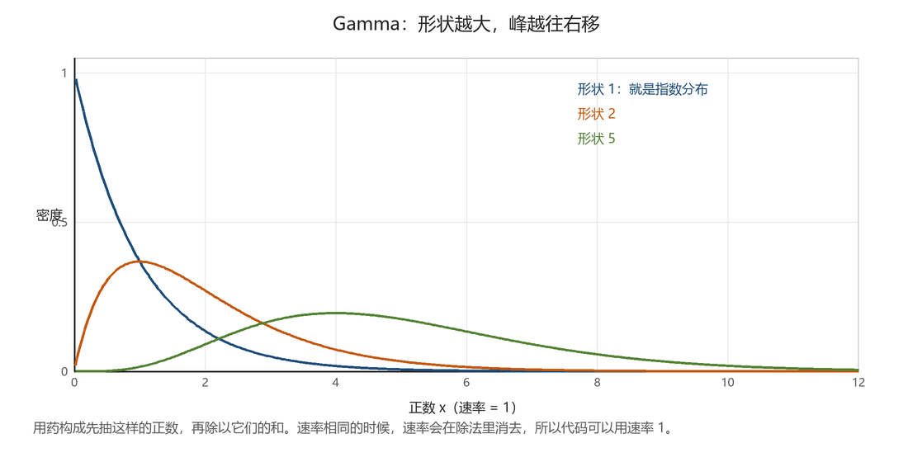

形状为 1 的 Gamma 就是指数分布，密度从纵轴最高点往右下降。形状为 2 和 5 时，密度在 0 处是 0，峰出现在横轴的正数位置，形状越大峰越靠右。代码抽用药构成时，形状参数就是各类的计数，可以是 117、3 或 310 这样的大数。那些曲线会非常窄，并且峰靠近各自的形状参数，因为速率是 1 时 Gamma 的均值等于形状。归一化以后，人们看到的不再是这些很大的正数，而是相加为 1 的比例。

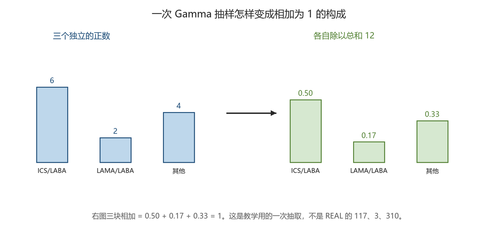

左图的 6、2、4 是教学用的一次抽取。右图是除以 12 之后的比例。REAL 的主分析不随机，直接使用 117、3、310 这些计数除以 430。PSA 则每次重新抽三个 Gamma，再做右图这一步，所以构成会在计数比例附近摆动，而不是永远等于 117/430。

三类构成是同一步，类数从 2 变成 3。设 X1、X2、X3 独立，各自服从 Gamma(αj, 速率 1)，S = X1 + X2 + X3，则

```text
( X1/S,  X2/S,  X3/S )
```

服从 Dirichlet(α1, α2, α3)。每一类的均值是 αj / (α1 + α2 + α3)。三类相加为 1，并且互斥。Blitzstein 这本书没有使用 Dirichlet 这个名字；8.5 写的是两类，结果叫做 Beta。Dirichlet 这个名称来自健康决策模型对多项构成的常规选择（Briggs 等，2012）。代码注释写的是「三类 Gamma 各除以本行总和，得到 Dirichlet 处方构成」。

REAL 的形状参数就是各类计数，速率为 1：

| GOLD | ICS/LABA | LAMA/LABA | 其他 | 合计 |
| --- | ---: | ---: | ---: | ---: |
| I | 117 | 3 | 310 | 430 |
| II | 498 | 21 | 1256 | 1775 |
| III | 393 | 25 | 1026 | 1444 |
| IV | 138 | 5 | 432 | 575 |

其他类等于该级总人数减去前两类。GOLD I 的其他类是 430 − 117 − 3 = 310。这张表与 `TableA1_PSA_parameters.csv` 一致。抽完以后再算二联内部权重，分母仍只含两类二联：

```text
w_g = n_ICS/LABA / ( n_ICS/LABA + n_LAMA/LABA )
```

## 8. 顺序统计量、大数定律，以及两种「95%」

### 8.1 先把结果排队

把一批数从小到大排列，排好以后的第 1 个、第 2 个，直到最后一个，叫顺序统计量（Blitzstein 8.6）。用 10 个教学结果看排队：

```text
原顺序：  8, 1, 5, 5, 9, 2, 4, 7, 3, 6
从小到大：1, 2, 3, 4, 5, 5, 6, 7, 8, 9
```

最小的 1 是第 1 个顺序统计量，最大的 9 是第 10 个。中位数是排在正中间的位置。百分位数是排队以后、按百分比找位置。第 2.5 百分位数靠近左端，第 97.5 百分位数靠近右端。

PSA 的 95% 不确定区间，就是 1,000 个模型结果的第 2.5 与第 97.5 百分位数。代码写的是 `quantile(value, 0.025)` 和 `quantile(value, 0.975)`。R 的 `quantile` 默认用 type 7 做插值，不是机械地取排序后的第 25 个和第 976 个。顺序统计量说明「区间来自把模拟结果排队」；精确端点以这个 `quantile` 为准。

这个区间描述的是：已经进入抽样的那些参数按既定分布变动时，模型结局的散布。死亡 HR、GOLD 权重、严重加重史的死亡权重和覆盖路径没有进入抽样，也就没有进入这个区间。它回答的是抽样方案内部的散布，不是「真实全国效果有 95% 的概率落在这里」。

### 8.2 文献里的 95% 置信区间是另一条区间

参数的 95% 置信区间来自原来的临床试验或荟萃，针对的是某一个相对风险。`ln_sd` 只借用这个区间的宽度，把它换成对数正态的标准差。转换完成以后，这个区间的任务就结束了。模型跑完 1,000 次之后得到的百分位数，描述的是结局，稿件把它叫作不确定区间（UI）。

两条区间可以接在一起，但名称要换：文献区间描述效应估计有多宽；UI 描述把这些效应放进模型以后，死亡或 DALY 有多宽。

### 8.3 大数定律稳定的是抽样均值

大数定律（Blitzstein 10.2）说：独立、同分布抽样的样本均值，随着次数增加，靠近该分布的期望。把一枚公平硬币投 20 次，正面比例可能是 0.40 或 0.70；投很多次以后，比例会靠近 0.50。

PSA 从很少几次增加到 1,000 次，模拟均值会稳定到「这些被抽样参数随机化之后的结局期望」附近。次数再增加，稳定的仍是这个期望。没有放进抽样的结构假设，不会因为次数变多而自动进入区间。1,000 是预先设定的蒙特卡罗次数，不是临床样本量。

## 9. 离散时间 Markov 链

### 9.1 用天气把定义算一遍

Blitzstein 第 11 章处理有限个状态、离散时间的链。状态是一份有限名单，时间是第 0 步、第 1 步、第 2 步。书中的晴雨例子可以做完整个定义。状态只有雨和晴。今天雨，明天雨的概率是 1/3，晴的概率是 2/3。今天晴，明天雨和晴的概率都是 1/2。转移表是

```text
          明天雨    明天晴
今天雨     1/3       2/3
今天晴     1/2       1/2
```

两行都加总为 1。定义 11.1.1 的 Markov 性是

```text
P(下一步 = j | 现在 = i, 昨天, 前天, …)
    = P(下一步 = j | 现在 = i)
```

对这个例子，明天的天气概率只看今天是雨还是晴。昨天的天气一旦已经体现在今天里，就不再另外进入公式。已知现在，过去和未来在这个定义下条件独立。

设今天下雨的概率是 0.30，晴天的概率是 0.70。明天雨的概率用全概率：

```text
0.30 × (1/3) + 0.70 × (1/2)
= 0.30 × 0.3333 + 0.70 × 0.5000
= 0.1000 + 0.3500
= 0.4500
```

明天晴的概率是 1 − 0.4500 = 0.5500。这就是行向量 (0.30, 0.70) 乘上转移表。

### 9.2 时齐：同一张表一直用下去

书中默认链是时齐的：P(下一步 = j | 现在 = i) 不随时间改变，因此一张 Q 可以一直用（11.1 对 time-homogeneous 的说明）。晴雨例子若每天都用上面那张表，就是时齐的。

本研究的患者链保留 Markov 性：下一步的概率由当前的 GOLD、当前的 H、当前的治疗和当年的转移概率决定。它不是时齐的。同一个人今年 60 岁、覆盖率 10%，明年 61 岁、覆盖率 15%，死亡概率和治疗概率都变了。每一年有自己的 Q_t。多步转移是这些矩阵按年相乘。

### 9.3 吸收态

状态分类在 11.2。吸收态是进去之后不再离开的状态。在矩阵里，它那一行是自己的位置为 1，其余为 0。晴雨例子里没有吸收态，雨和晴可以互相走到。

本研究的全因死亡是吸收态。死亡行写成「以概率 1 留在死亡」。在每年死亡概率都大于 0 的模型里，各个存活状态都会把一部分人送向死亡。11.2 还讨论互通、周期和不可约，那些概念用来判断同一张矩阵长期使用时还能不能回到原状态。25 年的政策计算使用逐年更换的矩阵，答辩时把死亡说成吸收态就够用了。

### 9.4 平稳分布：比例再乘一次也不变

平稳分布（11.3）是一个行向量 s，满足

```text
s × Q = s
s 的各分量 ≥ 0，并且相加等于 1
```

含义是：如果现在的比例已经是 s，再乘一次同一个 Q，比例不变。在时齐、并且满足书中定理的条件下，时间足够长以后，Q 的高次方的每一行都靠近 s。

用晴雨例子把 s 求出来。设长期下雨的比例是 p，晴天比例是 1 − p。乘一次以后仍下雨，要求

```text
p × (1/3) + (1 − p) × (1/2) = p
```

左边展开：

```text
p/3 + 1/2 − p/2 = p
1/2 + p/3 − p/2 = p
1/2 = p − p/3 + p/2
1/2 = (6p − 2p + 3p) / 6
1/2 = 7p / 6
p = 3/7 = 0.4286
```

所以长期比例大约是雨 0.4286、晴 0.5714。可以用这个比例再乘一次 Q，核对明天雨的概率是否仍约 0.4286。这就是平稳分布在做的事。

本研究不求这个比例。转移矩阵每年更换，不存在那一张被反复使用的 Q。队列是开放的，每年有新患者进入。决策看的是 25 年内的累计死亡和加重，而不是无穷远以后各状态的比例。

可逆性（11.4）要求细致平衡：在平稳分布下，从 i 到 j 的流量等于从 j 到 i 的流量。本研究没有使用这个条件。

### 9.5 一个人的链，和一群人的期望人数

第 11 章的 X_n 是一个人的状态序列。第 3 节把许多人的指示变量加总成期望人数。两节合在一起，才是「人数行向量乘当年的转移矩阵」。

若「过去一年是否严重加重」会影响明年，就把这个信息写进状态名，使下一步仍然只依赖当前状态。这是用增加状态来保留一段病史的标准办法（Siebert 等，2012）。本研究的 H0、HM、HS 保留的是过去一年，不是患者一生的全部加重次数。

一个周期内部还要和连续时间竞争风险分开。竞争风险是同一段时间里多个事件抢同一个发生时刻。本研究的年度循环是：用年初状态计算死亡，从人数里扣除死亡，再把幸存者分到年末的 H0、HM、HS。加重患者年度用年初人数乘概率，不追查加重和死亡在这一年里谁先发生。Sonnenberg 与 Beck（1993）讨论的是离散周期上的状态转移，并建议用半周期校正处理「死亡发生在周期内部」对存活时间的影响。那是人年的校正，模型仍按年推进。

## 10. 直接抽样和 MCMC

第 12 章解决的问题是：目标分布很难直接抽样，甚至归一化常数都不知道。办法是造一条 Markov 链，使想要的分布正好是它的平稳分布，然后把链跑很久，用后面的状态当作样本。Metropolis–Hastings（12.1）和 Gibbs 抽样（12.2）都是这种构造。

可以用两种取随机数的方式作对照。第一种，骰子的六个面可以直接投，这是直接抽样。第二种，若目标分布复杂到没有现成的投掷方法，就构造一个会走动的链，走到后来，落在各处的频率接近目标分布。第二种才是 MCMC。它依赖第 9 节的平稳分布：链的平稳分布被设计成想抽样的那个分布。

本研究的参数分布可以直接抽样。对数正态用 `exp(rnorm())`，Beta 用 `rbeta`，Gamma 用 `rgamma`。抽完一组参数，就把模型整条跑完，得到一个结局。下一次抽样与上一次独立，共用随机数种子 20261009，是为了以后能复核同一批数。这里没有为了抽样去构造一条以结局分布为平稳分布的链。

因此这次分析是蒙特卡罗：对参数的分布做重复抽样，再计算模型输出的分布。患者状态那条按年推进的链，和第 12 章为了抽样而造的链，是两件工具。PSA 使用的是直接抽样。

# 第二部分 本研究的 Markov 模型

## 11. 模型在回答什么

问题是：2025–2049 年，在预设的覆盖路径和效应下，把三联治疗、肺康复、家庭 NIV 或三者的联合包扩大到中国 40 岁及以上 COPD 患者中的当年合格人群，相对于模型里的参照情景，会减少多少死亡和加重患者年度，并连带多少伤残调整寿命年和质量调整寿命年。

参照情景称为 BAU。主分析里，这三项服务的追加覆盖近似为 0。BAU 仍使用 WPP 死亡率和 COPD 患病比例，所以它保留了一般人群和 COPD 死亡资料里已经包含的诊疗背景。BAU 的显式覆盖写成 0，这个 0 是模型参照，不是全国实测覆盖率。

差值方向先记牢。死亡、加重、YLL、YLD、DALY 用 BAU 减干预，正数表示减少。存活人年和 QALY 用干预减 BAU，正数表示增加。（讲稿；代码 `v13_summarise` 里 averted 与 gained 两套字段。）

## 12. 状态、周期和开放队列

周期是 1 年。主分析从 2025 年到 2049 年，共 25 个周期。累计终点取第 5、10、15、20、25 年。

活状态是 GOLD I–IV 与 H0、HM、HS 的组合，共 12 个。H0 表示过去一年没有加重，HM 表示只有中度加重，HS 表示至少有一次严重加重；同一年里既有中度又有严重，归入 HS。吸收态是全因死亡。

GOLD 在个体上不进展：一个人进入时被分到某个 GOLD 级，以后仍留在这个级。人群里各级的比例仍会变化，因为各级死亡概率不同，新进入者又按固定构成补充。个体 GOLD 保持原级，全国 GOLD 构成仍可以逐年变化。

另有一些属性贴在人身上，不作为转移状态：年龄、性别、二联类型（ICS/LABA、LAMA/LABA、其他）、高碳酸血症，以及三联、家庭 NIV、肺康复是否处于治疗中。高碳酸血症在进入时按比例拆开，以后不随状态重新抽取。

入口是开放的。2025 年的存量等于 WPP 人口乘以 GBD 2023 患病率。此后，新发病等于当年 BAU 中尚未患 COPD 的人数乘以

```text
1 − exp(−发病率)
```

发病率保持 2023 年的年龄别、性别别数值。这个式子就是第 4 节的「恒定强度下至少发生一次」。15–39 岁是储备池，不接受这三项干预，满 40 岁后进入主模型。主分析中，真正的新发病例以 H0 进入；2025 年存量和跨过 40 岁的既有病例，按监测的加重史构成分配 H。

## 13. 一个周期里事情的顺序

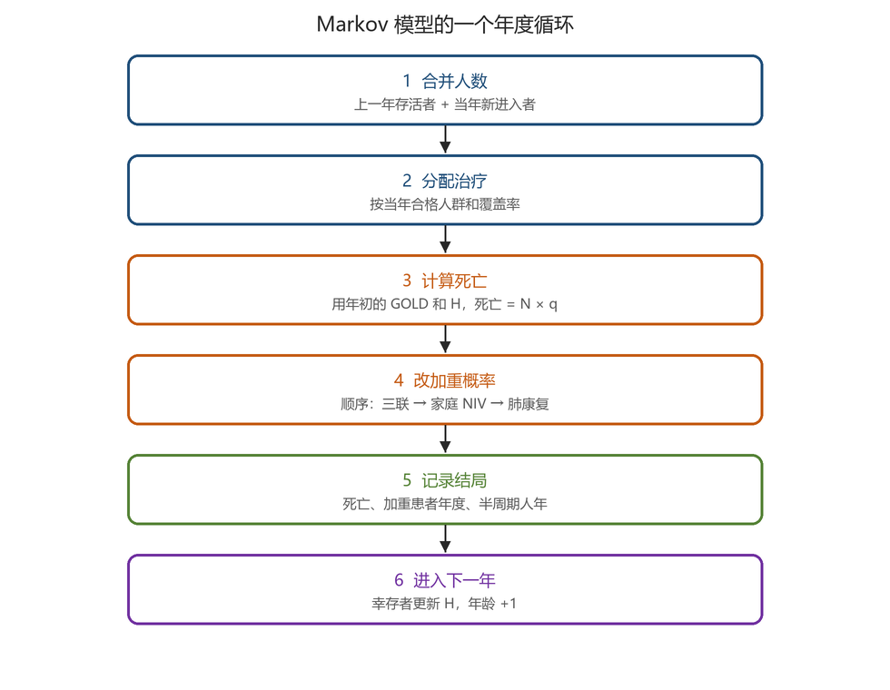

代码 `v13_step` 的顺序是：

1. 年初把上一年的存活者与当年新进入者放在一起。
2. 按合格人群和当年覆盖率分配治疗。三联和家庭 NIV 一旦开始就继续；肺康复每年清掉上一年的治疗标志，只对当前 HS 重新分配一年。
3. 用年初的 GOLD 和 H 计算死亡概率，期望死亡人数为 N × q。
4. 在同一年初人数上计算加重概率。干预按固定顺序修改这个概率：先三联，再家庭 NIV，再肺康复。
5. 记录死亡、加重患者年度和人年。
6. 幸存者按今年的加重结果进入年末的 H0、HM、HS，年龄加 1，100 岁以上停在开放组。

因为死亡用的是年初状态，今年刚被干预改变的加重结果，要到下一年才变成新的 H，才影响死亡。死亡收益从干预实施的下一年开始出现。

设年初某格人数为 N，死亡概率为 q，任意加重概率为 p，严重加重概率为 p_S，仅中度概率为 p − p_S。幸存者是 N × (1 − q)。年末人数是

```text
N_H0 = N × (1 − q) × (1 − p)
N_HM = N × (1 − q) × (p − p_S)
N_HS = N × (1 − q) × p_S
N_死亡 = N × q
```

四项加总回到 N。这就是该格的一行转移概率，算法和第 1 节的行向量相同。加重患者年度是 N × p 和 N × p_S，用的是年初 N，不是幸存者。每人每年最多计 1 个任意加重患者年度、1 个严重加重患者年度；下一年可以再计。这个数是患者年度，不是住院次数，也不是一年内的发作次数。

## 14. 背景死亡怎么拆开

WPP 给的是全人口中央死亡率 m，里面既有 COPD 患者，也有非 COPD 者。设该层 COPD 比例为 P，COPD 相对于非 COPD 的全因死亡风险比为 HR。主分析 HR = 1.44，文献区间 1.41–1.47。模型把 m 近似当作强度，在强度尺度上做加权：

```text
m = (1 − P) × m_N + P × m_C
m_C = HR × m_N
```

因此

```text
m_N = m / [ HR × P + (1 − P) ]
m_C = HR × m_N
q_C = 1 − exp(− m_C)
```

（代码 `calc_q_copd`；讲稿中的分解。）q_C 是 COPD 患者的年度全因死亡概率，包含心血管等原因。Lancet 模块里的 COPD 死因死亡是另一套死因口径。

用一组教学数字把除法走完，这组数不是某个年龄格的真实输入。设 m = 0.02，P = 0.10，HR = 1.44。

```text
分母 = 1.44 × 0.10 + 0.90 = 0.144 + 0.90 = 1.044
m_N = 0.02 / 1.044 = 0.019157
m_C = 1.44 × 0.019157 = 0.027586
q_C = 1 − exp(−0.027586) = 0.027209
```

再把两个强度加权，应当回到 0.02：

```text
0.90 × 0.019157 + 0.10 × 0.027586 = 0.017241 + 0.002759 = 0.020000
```

加权发生在强度上，年度概率 q_C 用指数从 m_C 转换。P 用当年 BAU 的 COPD 存量除以当年 WPP 人口。干预不改变非 COPD 者的死亡。

## 15. GOLD 和加重史上的死亡校准

GOLD I–IV 的相对权重主分析取 1.07、1.33、2.27、4.16。在每个年龄、性别、年份上，用当年 BAU 的实际 GOLD 构成 π_g，求一个 h*，使加权死亡概率等于上一节的 q_C：

```text
Σ  π_g × [ 1 − exp(− w_g × h*) ]  =  q_C
q_g = 1 − exp(− w_g × h*)
```

（代码 `solve_h_star`。）这是数值求根，不是新做一次回归。求根的目的，是让分层之后的平均死亡概率回到已经分解好的 q_C。它就是第 2 节的全概率等式，只是 q_g 被规定成带有共同未知数 h* 的指数形式。

加重史再分一次。相对权重 r_H 为 H0 = 1、HM = 1、HS = 1.26。HM 取 1 是模型设定；1.26 来自严重加重史与全因死亡的关联。记 λ_g = − ln(1 − q_g)。对每个 GOLD 级求一个系数 k，使

```text
q_(g,h) = 1 − exp(− k × r_h × λ_g)
Σ  v_h × q_(g,h)  =  q_g
```

v_h 是该级内部各 H 的构成。代码先在 BAU 上算出 k，干预情景沿用同一套 k 和同一套 q_g，不再按干预后的 H 构成重新求。

这一条决定了死亡差能否留下来。若在干预情景上按新的 H 构成把 k 重新求一遍，加权平均又会被拉回原来的 q_g，减少 HS 所带来的死亡下降会被校准等式抵消。锁在 BAU 上，是为了让「HS 比例下降」能够改变实际的平均死亡概率。

若 1.26 只是观察性关联、不能随干预后的状态移动，则模型会把这条关联全部记成死亡收益。稿件把这一点列为局限：PSA 没有重抽这个权重。

## 16. 加重概率

监测给出的是某一 GOLD 层全体患者的年度比例，还没有按有无加重史拆开。任意加重比例 p_g 为：I 级 0.046，II 级 0.107，III–IV 级 0.287。住院比例 u_g 为 0.017、0.046、0.189。有既往加重史者相对于无史者的发生率比取 2.66。

设无史强度为 λ0，有史强度为 2.66 × λ0。当前设定把校准用的有史份额 a_g 取成 p_g 本身，并要求混合概率回到监测比例：

```text
(1 − a_g) × [1 − exp(−λ0)] + a_g × [1 − exp(−2.66 × λ0)]  =  p_g
```

然后

```text
p0 = 1 − exp(−λ0)
p1 = 1 − exp(−2.66 × λ0)
```

H0 用 p0，HM 和 HS 用 p1。严重加重在任意加重中的条件份额 s = u_g / p_g，同一 GOLD 级内不随 H 改变。p_S = p × s。这仍是第 2 节的加权平均，加第 4 节的指数转换。

讲稿里的一个复算可以用来核对这条链：GOLD II、年初为 HS、尚未加三联和家庭 NIV 时，λ0 = 0.0971102146291，有史者任意加重概率

```text
1 − exp(−2.66 × λ0) = 0.2276466844
```

严重份额是 0.046 / 0.107，所以该层基础严重概率约为 0.0979。这是参数在当前设定下的复算，不是假设的患者人数。

模型运行以后，不再每年把加重比例强制拉回监测的 p_g。死亡校准会每年按 BAU 的构成重求 h*；加重概率在入口处校准一次，随后随人群的 H 构成自己走。

## 17. 三项干预怎样改概率

三项都没有直接的死亡乘数。它们只改当年的加重概率。

三联的输入是发生率比：相对于 ICS/LABA 为 0.85（0.80–0.90），相对于 LAMA/LABA 为 0.75（0.70–0.81），来自 IMPACT。同一 GOLD 级内，二联内部权重 w_g 如第 7.3 节。主分析先混合发生率比，再做指数转换：

```text
IRR_g = 0.85 × w_g + 0.75 × (1 − w_g)
p_full = 1 − (1 − p) ^ IRR_g
```

用第 6.3 节 GOLD II 的 w = 0.9595 看混合结果：

```text
IRR = 0.85 × 0.9595 + 0.75 × 0.0405
    = 0.8156 + 0.0304
    = 0.8460
```

因为二联内部几乎都是 ICS/LABA，混合后的发生率比靠近 0.85，而不是 0.85 和 0.75 的简单平均 0.80。

持续份额 ρ 描述开始治疗后仍维持有效治疗的比例。主分析 ρ = 0.725，年衰减为 0，所以每年都是 0.725。在治者的概率是

```text
p_T = ρ × p_full + (1 − ρ) × p
```

ρ 只稀释效应。覆盖率的分母仍是当年合格人数，不把 0.725 再乘进覆盖率。0.725 的人得到 p_full，其余 0.275 的在治者仍用原来的 p，两者再加权。这是第 2 节的全概率，两类是「效应还在」和「效应已经不在」。

家庭 NIV 只作用于在治者，把任意加重概率直接乘以 0.71，并截断在 1：

```text
p ← min(1,  p × 0.71)
```

严重条件份额不变。0.71 的区间是 0.58–0.87。

肺康复只作用于本年被分配到的人，把严重分量乘以 0.70（0.58–0.85），任意加重总概率不变。减少的严重分量进入 HM。0.70 来自 48 周 COPD 相关再入院的合并风险比，证据确定性为低。模型把这个随访期风险比用作一年的严重加重概率乘数，并假设效应持续这一个模型年；下一年要重新处于 HS 并再次获得分配。

联合时的顺序与代码一致。记 I_T、I_N、I_P 为是否在治，取 1 或 0。R_N = 0.71，R_P = 0.70。

```text
p_A = (R_N ^ I_N) × { I_T × [ρ × p_full + (1 − ρ) × p] + (1 − I_T) × p }
p_S = p_A × s × (R_P ^ I_P)
```

指数上的 0 表示未治，任何正数的 0 次方是 1，相当于不乘这项。三联走 1 − (1 − p) ^ IRR，另外两项走概率相乘。p 较小时两种映射接近；p 不小时，两者不同。这是输入类型不同而做的映射。第 4.4 节已经用 p = 0.20、乘数 0.70 算过：乘方结果 0.14461，直接相乘结果 0.14000。

## 18. 覆盖路径

四条主路径的年增幅相同，终点不同。第 k 年的覆盖率是

```text
c_k = target × min(1,  k / ramp)
```

k = 1 是 2025 年。target = 0.25、ramp = 5 时，

```text
c_1 = 0.25 × min(1, 1/5) = 0.25 × 0.20 = 0.05
```

所以 2025 年已经是 5%，不是从 0 开始到年底才达到 5%。四条路径是：5 年达到 25%，10 年达到 50%，15 年达到 75%，20 年达到 100%，其后维持到 2049 年。另有一个即时 100% 的参照路径。

合格定义随服务变化。肺康复的合格者是年初存活且过去一年处于 HS 的人，每年重判。三联和家庭 NIV 有各自的合格规则，开始后持续治疗；持续治疗的人若已经不再属于当年合格人群，仍可留在治疗中，但这部分不进入覆盖分母。

背景覆盖扫描把三项同时放在 0、1%、5%、10%、20%、30%。实际覆盖取背景和路径的较大者，不把已经开始的治疗撤回。30% 是扫描上限，不是测得的全国覆盖率。

## 19. 计数、人年和健康年

死亡人数是 Σ (N × q)。加重患者年度是 Σ (N × p) 与 Σ (N × p_S)。转入下一年 HS 的人数是 Σ [ N × (1 − q) × p_S ]，先要求活过这一年。

存活人年用半周期校正：

```text
PY = N × (1 − q / 2)
```

当年死亡者按平均存活半年计入。N = 1000、q = 0.10 时，

```text
PY = 1000 × (1 − 0.05) = 950
```

若把年初 1000 人全年都算成人年，会得到 1000；若死亡者完全不计入，会得到 900。半周期取中间的 950。这个人年用于存活时间、治疗时间和 YLD，不用于加重患者年度。加重计数保持年初人数乘概率；代码里的 `THETA_MAIN = 0` 表示加重暴露不再额外乘死亡校正。

YLL 使用另一张时期寿命表。那张表的 q 是 m / (1 + 0.5 × m)，由存活函数 l_x、区间人年 L_x 和累计人年 T_x 得到期望余寿 e_x = T_x / l_x。死亡发生在这一岁内部，余寿取本岁和下一岁期望余寿的平均，记为 e_mid；100 岁以上用该开放组的余寿。未贴现的寿命损失是

```text
YLL_0 = Σ ( D × e_mid )
```

若某岁死亡 10 人、e_mid = 12 年，这一岁贡献 120 个寿命损失年。各岁相加得到全年的 YLL。

贴现先把余寿收成一笔年金，再按死亡发生的年份折回 2025 年。年金公式（代码 `v13_annuity`）是

```text
a(L, r) = { 1 − exp[ − ln(1 + r) × L ] } / ln(1 + r)     当 r > 0
a(L, 0) = L
```

第 k 个模型年的年份折现因子是 (1 + r) 的 −(k − 1) 次方。k = 1 对应 2025 年，因子为 1。因此

```text
YLL_r = [ Σ D × a(e_mid, r) ] × (1 + r) ^ (−(k − 1))
```

这里有两层时间：余寿内部按连续复利收成现值，再从死亡年份回到 2025 年。r = 0.03、L 很大时，a(L, 0.03) 会小于 L，因为将来的年份被折轻了。

YLD 只用 GOLD 级别人年，不按 H 分级：

```text
YLD_0 = Σ ( PY_g × DW_g )
```

残疾权重为：I 级 0.0193167208，II 级 0.2251717079，III 级与 IV 级共用 0.4078579768。权重来自 GBD 2023，III 与 IV 共用重度、无心力衰竭那一档。YLD 的年份折现是

```text
YLD_r = YLD_0 × (1 + r) ^ (−(k − 1))
```

不再对权重做年金化。然后

```text
DALY_r = YLL_r + YLD_r
```

QALY 用效用乘同一套人年。效用为 I 级 0.786、II 级 0.734、III 级与 IV 级 0.682，来自 Park 等表 1 的均值和标准误。QALY 不改变转移，只作为补充结局。

死亡和加重不折现。DALY 主报告未折现和 3%，5% 只做敏感性。QALY 同样报告未折现和 3%。

避免 YLD 可以为负。干预若延长生存，多出来的人年仍乘以正的残疾权重，YLD 上升。避免 YLD 等于 BAU 的 YLD 减干预的 YLD，生存延长时这一项为负。讲稿中情景 4、25 年、联合包、3% 折现的冻结分量是：避免 YLL 约 128,851 年，避免 YLD 约 −38,131 年，净避免 DALY 约 90,720 年。净值为正，是因为少损失的寿命年多于多出来的带病生存。避免死亡的对应冻结显示值是 18,523 例。这些是联合包情景 4 的确定性结果，不是肺康复单稿里的数字。

当前 YLD 没有单独计入加重发作那几天的额外伤残，也没有计入肺康复直接改善的生活质量。严重加重转成中度加重的短期收益，记在严重加重患者年度里，不记在这套 YLD 里。

标准化有两套分母。累计首次合格者每人只计一次，联合包取至少一项合格的并集，报告每 1,000 人。治疗人年用半周期存活时间，联合包按至少接受一项治疗去重，报告每 100,000 治疗人年。

## 20. 前提若换一种写法，结果会怎样

下面只写能从公式直接看出的方向。没有重新跑模型的数量，不写成新的结果。

- 若在干预情景上按新的 H 构成重求 k，加权死亡概率会被拉回原来的 q_g，死亡差会向 0 收缩。
- 若严重加重史与死亡的 1.26 不能随状态移动，现在记入的间接死亡收益会偏大。
- 若肺康复或 NIV 另有直接死亡效应而模型未放入，当年的死亡差里就没有这一项。模型现有的死亡差来自下一年起的 H 分布。
- 若把三联的发生率比直接乘在概率上，而不是使用 1 − (1 − p) ^ IRR，在 p 不小的格子上，治疗后的概率会不同。第 4.4 节的例子里，0.20 和 0.70 给出 0.14000 与 0.14461。
- 若人年不按半年计入死者，治疗人年、YLD 和 QALY 都会改变；加重患者年度不乘半周期校正。
- 若 YLD 加上急性加重的短期伤残，肺康复把严重加重转为中度的那一部分会出现在 YLD 里。现行避免 YLD 不含这一笔，读数更反映生存延长。
- 个体 GOLD 不进展，长期外推时病情迁延不会通过 GOLD 升级进入更高的死亡权重和残疾权重。人群构成仍会因死亡和入口改变。

# 第三部分 概率敏感性分析里的每一个分布

## 21. PSA 在做什么

正式 PSA 固定 BAU，只跑情景 4（20 年达到 100% 后维持），种子 20261009，抽样 1,000 次。同一次抽样同时跑三联、肺康复、家庭 NIV 和联合包。95% UI 是这 1,000 个结局的第 2.5 与第 97.5 百分位数，外加样本均值、中位数，以及结局大于 0 的比例。

被抽样的是干预效应、治疗构成、持续份额、高碳酸血症比例、残疾权重和效用。死亡分解、GOLD 权重、H 的死亡权重、加重史倍率 2.66、发病率和覆盖路径保持主分析点值。BAU 不按抽样结果重新校准。

除两项三联效应在对数尺度上相关系数设为 1 以外，其余抽样相互独立。分布本身的构造已经在第 5–8 节算过，本节只把每个参数对上号。

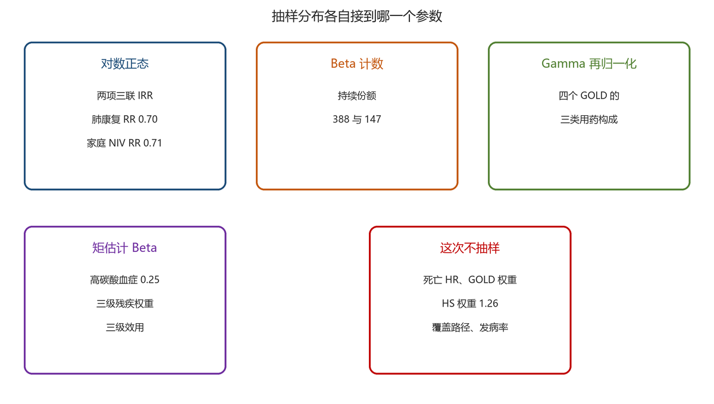

读这张图时按块看。对数正态那一块的三条曲线都只取正数，其中两项三联共用一个正态随机数。Beta 计数那一块的两个参数是人数。Gamma 再归一化那一块先得到正数，再变成构成。矩估计 Beta 那一块没有人数，形状是由均值和标准误反解的。红色一块提醒：死亡 HR、GOLD 权重、1.26 和覆盖路径留在抽样之外，所以它们的变动不会出现在 95% UI 里。

## 22. 逐个参数

**两项三联发生率比。** 对数正态。中心分别为 ln(0.85) 与 ln(0.75)，标准差由 0.80–0.90 和 0.70–0.81 按 `ln_sd` 反推。共用一个 Z ~ N(0, 1)，对数尺度相关系数为 1。来源是 IMPACT；相关结构是模型假设。它们进入 1 − (1 − p) ^ IRR，并改变以后年份的 H，从而间接改变死亡、YLL 和 YLD。

**三联 12 个月持续份额。** Beta(388, 147)，来自 Lin 等单吸入器持续治疗 388/535。均值约 0.72523。主分析点值是四舍五入的 0.725。它只在效应混合里出现，不进入覆盖分母。

**二联及其他用药构成。** 四个相互独立的 Dirichlet，形状参数为第 7.3 节的计数表，由三组 Gamma(计数, 速率 1) 归一化得到。来源是 REAL 的治疗模式计数。抽到的构成决定 w_g，也决定各 GOLD 级里进入三联合格池的相对大小。

**肺康复严重加重风险比。** 独立对数正态，中心 ln(0.70)，区间 0.58–0.85。只乘严重分量。来源是 Meneses-Echavez 等 2023 的 48 周再入院合并风险比。

**家庭 NIV 任意加重风险比。** 独立对数正态，中心 ln(0.71)，区间 0.58–0.87。直接乘任意加重概率。来源是 Pitre 等 2024。这里的 0.71 是加重风险比。Lancet 模块的住院死亡风险比是 0.54，两处数字对应两套模型。

**高碳酸血症比例。** 矩估计 Beta。均值 0.25，标准误按 0.25 × 0.20 = 0.05 预设，得到 Beta(18.5, 55.5)。0.20 这个相对标准误是假设，形状参数不是由 58/231 这种计数拟合出来的。点值 25% 来自 HOmeVent 的 PaCO₂ 阈值。它决定家庭 NIV 合格比例的大小。第 5.3 节有完整验算。

**残疾权重。** 三个矩估计 Beta，均值分别为 0.0193167208、0.2251717079、0.4078579768。标准误由不确定区间宽度除以 2 × qnorm(0.975) 得到。区间是 0.0106353925–0.03272288、0.15291988–0.3097289925、0.2734113675–0.555659085。III 级和 IV 级共用重度那一次抽样。残疾权重只改 YLD 和 DALY，不改转移、死亡和加重。

**效用。** 三个矩估计 Beta，均值 0.786、0.734、0.682，标准误 0.085、0.158、0.122，来自 Park 等表 1。只改 QALY。

## 23. 没有进入这次 PSA 的参数

这些参数有单因素敏感性或情景替换，但 1,000 次联合抽样不重抽它们：

- COPD 死亡 HR 1.44（1.41–1.47）。
- GOLD 权重，以及 Niedermaier 的替代权重组。
- HS 死亡权重 1.26（1.14–1.38）；HM 的权重固定为 1。
- 加重史倍率 2.66（2.14–3.30）。
- 新发病例全部以 H0 进入，相对于按现患 H 构成进入。
- 三联效应衰减：主分析为 0，敏感性为每年 5% 或 10%；持续份额的替代值 0.576 和 1。
- 中国肺康复替代效应 0.512；高碳酸血症比例的替代阈值 9%。
- DALY 折现率 5%。
- WPP 人口与死亡率、GBD 患病和发病率、GOLD 的入口构成、监测加重比例、四条覆盖路径。

UI 的宽度只反映第 22 节那一组分布。把 UI 说成全部不确定性，会把上面这些结构设定留在区间外面。

# 第四部分 Lancet 模块的健康收益

## 24. 原文在算什么

NCD Countdown 2030（*Lancet* 2022;399:1266–1278）要回答的是：在低收入和中等收入国家，一组非传染性疾病干预若扩大覆盖，能否加快接近可持续发展目标 3.4，以及不同干预在花费下的相对效率。正文用两种覆盖实验。一种是 2023 年把干预覆盖立刻提高到 90% 并维持到 2030，用来看距离目标还差多少，参考情景下低收入和中等收入国家合计约避免 3,900 万死亡。另一种是 2023 年把每项干预的覆盖立刻提高 10 个百分点并维持，用来在基线覆盖不同的干预之间比较成本效果。原文的主要效率指标是每花费 100 万美元所对应的、30–70 岁 NCD4 死亡概率下降；每避免 1 个 DALY 的成本是次要分析。

避免死亡的算法，是用参照情景的死因死亡数，减去不采取额外行动时的死因死亡预测。人口基线锚定联合国人口司的中方案。效应通常来自试验或荟萃的率比或风险比，再乘上覆盖率的改变。项目已核对的补充材料步骤还包括：实施效果打八折，以及用年龄标化的 YLD/YLL 比近似 DALY、并且不折现。补充 PDF 没有另存成可检索全文，这里只使用方法稿里已经写明、并与正文相符的步骤，不补写未核对的附录句子。

本研究的 Lancet 模块借用这套「覆盖改变死因死亡率、再由死亡差计算健康年」的框架，不逐项复现原文的国家参数，也不做原文的成本排序。

## 25. 本研究的急性 NIV 条件情景

首轮只算 40 岁及以上人群的急性 NIV，时间是 2025–2049 年，期末看到 2050 年初。人口、全因中央死亡率和时期余寿来自 WPP 2024 中国中方案。COPD 死因份额来自 GBD 2023：疾病死亡率除以全因死亡率，得到死因份额；2010–2023 年的对数份额对年份做回归，锚定 2023 年并外推到 2030 年，2030 年以后份额保持不变。未来的 COPD 死因死亡率等于这个份额乘以该单岁、该性别的 WPP 全因中央死亡率。份额固定时，疾病死亡率仍可变化，因为 WPP 的全因死亡率仍在变。

临床效应用 Osadnik 等的住院死亡合并风险比 RR = 0.54（0.38–0.76），比较的是双水平 NIV 加通常治疗与通常治疗。它作用在本次住院的时间窗上。模型把它映射为当年 COPD 根本死因死亡率的下降。一次治疗对应的是当年的适应证事件，模型不把非 COPD 死因的死亡率改掉。

适应证死亡份额 f_B 是：已经含有现有治疗的 COPD 死亡里，有多大比例属于这项服务的对象。它和「COPD 占全因死亡的份额」是两个比例。主值是

```text
f_B = (152041 / 1057454) × (22 / 77) = 0.0410800713
```

第一项是 Tong 等报告的中国医疗机构 COPD 死亡份额，第二项是 Plant 等英国住院调查里持续酸中毒死亡占住院 COPD 死亡的 22/77。这是跨国家和跨时间的代理构成，固定在各年龄、性别和年份上使用。

基线覆盖 w0 = 0.30，主情景在 2025 年提到 w1 = 0.40 并维持到 2049 年。90% 是补充情景。这两个覆盖率是工作假设，不是中国的测量值。实施修正 k = 0.8 只乘在新增影响上一次。疾病死亡率的相对下降幅度是

```text
I = k × f_B × (1 − RR) × (w1 − w0)  /  [ 1 − w0 × (1 − RR) ]
```

把主情景的数代进去：

```text
分子 = 0.8 × 0.0410800713 × (1 − 0.54) × (0.40 − 0.30)
     = 0.8 × 0.0410800713 × 0.46 × 0.10
     = 0.0015117466

分母 = 1 − 0.30 × (1 − 0.54)
     = 1 − 0.30 × 0.46
     = 1 − 0.138
     = 0.862

I = 0.0015117466 / 0.862 = 0.0017537664
```

约 0.175%。90% 情景的 I = 0.0105225983。

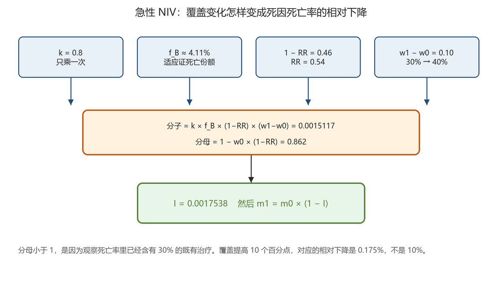

图的上面四格是一次相乘的四个因子。它们全部进入分子。分母只用其中的基线覆盖和 1 − RR，用来承认观察死亡率已经含有一部分治疗。下面的绿色结果 I 再去乘原来的 COPD 死因死亡率。图中没有成本，也没有患者的 GOLD 或加重史。

分母的来历可以分成两步。设未治疗者的死亡风险为 d_U。基线时已有比例 w0 的人接受治疗，观察到的混合风险是

```text
d_B = d_U × [ 1 − w0 × (1 − RR) ]
```

覆盖从 w0 增到 w1，未治疗风险尺度上的下降还要除以这个已经含有基线治疗的混合比例，才得到相对于观察基线的下降幅度。主情景里，分母 0.862 表示观察基线已经因为 30% 的既有治疗而低于「全员未治疗」。覆盖率提高 10 个百分点，对应的全国 COPD 死因死亡率相对下降是上面算出的 0.175%，要同时乘上 f_B、1 − RR 和 k，再除以这个分母。然后

```text
m1_COPD = m0_COPD × (1 − I)
m1_全因 = m0_全因 − m0_COPD + m1_COPD
```

其他死因的死亡率保持原值，全因死亡率只减去 COPD 死因上少掉的那一块。

两情景从同一个 2025 年初人口出发。出生和外部人口增减在两情景的差里抵消，只把干预情景多活下来的人推进到下一年。年度死亡概率用生命表关系

```text
u_x = m_x / [ 1 + (1 − a_x) × m_x ]
```

a_x 是该岁死亡者平均已经活过的比例。a_x = 0.5 时，这一式就是 Markov 寿命表里的 m / (1 + 0.5 × m)。这里用它做人口存活。Markov 状态转移里的 1 − exp(−m) 用在患者格子的死亡概率上。

在这套死亡与存活共用同一生命表的实现下，累计净避免的全因死亡等于 2050 年初的额外存活人数。COPD 死因死亡的减少可以更大，因为被避免的 COPD 死因死亡者后来仍可能死于其他原因；那些后来的死亡留在全因死亡里，不再算进净避免的全因死亡，但仍算进 COPD 死因死亡的减少。

YLL 用同年、同年龄、同性别的基线时期余寿：

```text
ΔYLL = Σ_年份 Σ_年龄,性别  (D0 − D1) × e0
```

这是一般人口的时期余寿，统计的是按基线余寿加权的死因死亡差，不截断在 2049 年。期内净人年是 2025–2049 年两情景的暴露人年之差，暴露人年由该年龄的全因死亡数除以中央死亡率恢复。净人年停在研究期末。YLL 和净人年回答两个时间范围。

Lancet 近似 DALY 沿用比例法。取 GBD 2023 中国、男女合计、全年龄的年龄标化率：

```text
ρ = 105.14471416471 / 667.6100344351883 = 0.15749420880659

ΔYLD_L = ρ × ΔYLL
ΔDALY_L = (1 + ρ) × ΔYLL
```

它假定伤残损失与寿命损失按同一个比例一起变化，不模拟未来谁处于哪个 GOLD 级。全年龄的标化比与 40 岁以上的研究对象也不完全对应。死亡下降后，带病生存可能使 YLD 上升；这个比例法按固定 ρ 让 YLD 随 YLL 同向变化。结果称为 Lancet 近似 DALY，并且不折现。

主情景在 f_B = 4.108007%、RR = 0.54、k = 0.8、覆盖 30% 到 40% 时，2025–2049 年累计净避免全因死亡 20,995 人，COPD 死因死亡减少 50,669 人，2050 年初额外存活 20,995 人，YLL 减少 449,005 年，期内净增加人年 315,361，Lancet 近似 DALY 减少 519,721 年。90% 补充情景的净避免全因死亡是 126,023 人。这些是条件点值，没有概率区间。

f_B 的三个替代值 2.103630%、5.056433% 和 7.989936%，来自同一中国医疗机构死亡份额，乘上 Roberts 住院资料里三种酸中毒死亡构成（109/745、262/745、414/745）。它们检验「适应证死亡池怎么定义」。它们是定义替换下的点值，区间的两端不是置信限，也不是全国效果的上下界。

## 26. 和 Markov 通道怎样并排说明

| 问题 | Markov 通道 | Lancet 急性 NIV 通道 |
| --- | --- | --- |
| 人在哪里 | COPD 患者的 GOLD × 加重史 | 一般人口的年龄、性别和死因 |
| 效应写在哪 | 加重概率；死亡经下一年的 H 改变 | COPD 根本死因死亡率 |
| 家庭或急性 NIV 的数字 | 加重风险比 0.71 | 住院死亡风险比 0.54 |
| 年内概率 | 状态转移用 1 − exp(−λ) | 人口存活用 m / [1 + (1 − a) × m] |
| DALY | 人年乘 GBD 残疾权重，加 YLL；可折现；避免 YLD 可为负 | (1 + ρ) 乘 YLL；不折现；称为近似 DALY |
| 不确定性 | 情景 4、1,000 次 PSA | 条件点值；f_B 做定义敏感性 |
| 成本 | 这套健康收益计算不计算成本效果 | 同样不计算成本，也不做原文的效率排序 |

答辩时若被问到健康收益，先说明问的是哪一条通道，再说差值的定义，最后说这一条没有计入的部分。Markov 的死亡差来自后续加重史，YLD 按 GOLD 人年计算，没有单列加重期额外伤残。Lancet 的 YLL 使用一般人口时期余寿，近似 DALY 按固定的 YLD/YLL 比例放大 YLL。

# 问答卡

以下只有题目。答案待理论包后续各节写完后再补，已有题目保留。

- Markov 性在第 11.1 节如何定义，本研究把更长病史放在哪个状态里
- 为什么推进期望人数，而不是逐人微观模拟
- 书中的链为什么默认时齐，本研究的转移矩阵为什么每年不同
- 平稳分布在算什么，为什么这里不求它
- 全因死亡为什么是吸收态，死亡收益为什么从下一年才出现
- 死亡校准为什么只锁在 BAU
- 肺康复为什么不直接乘死亡概率
- 1 − exp(−λ) 对应指数分布的哪一条性质，它和半周期校正各算什么
- 对数正态怎样由正态做变量替换得到
- Beta(388, 147) 的两个参数分别是什么计数
- 三类用药构成怎样从独立 Gamma 归一化得到；为什么不说 Blitzstein 写了 Dirichlet
- 两项三联效应为什么在对数尺度上用同一个随机数
- 1,000 次结果的 2.5 与 97.5 百分位数覆盖哪些参数，哪些结构假设没有进去
- 这次 PSA 为什么不是第 12 章的 MCMC
- 覆盖提高 10 个百分点时，COPD 死因死亡率的相对下降 I 是怎样算出来的
- Markov 的 DALY 和 Lancet 近似 DALY 各用什么公式
- 离散分布的柱高和连续分布的曲线高度，哪一个本身就是概率
- 同一条 Beta 密度，为什么均值附近的峰变窄以后，抽样结果会更靠近均值
